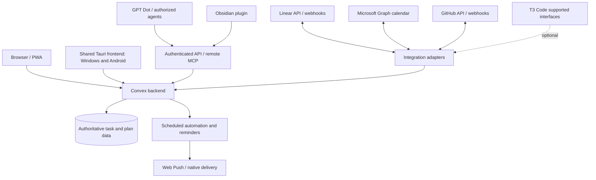

# Klaxon 2.0 — Product Design & Engineering Implementation Plan

**Status:** Proposed / ready for implementation planning  
**Date:** November 23, 2026  
**Repository:** [willherr72/Klaxon](https://github.com/willherr72/Klaxon)  
**Audience:** Project owner, T3 Code implementation agents, and independent reviewers  
**Delivery:** Incremental development on a `v2` branch; preserve the existing production application until migration and release gates pass.

---

## 1. Executive summary

Klaxon is evolving from a local-first reminder application into an **agent-accessible, automation-first personal task manager and daily planner**. It must provide a single trustworthy view of what the user needs to do, when they intend to do it, what is waiting on others, and how their commitments relate to existing tools.

The user primarily uses Klaxon for ordinary reminders and tasks, not persistent or escalating alarms. The existing peer-to-peer synchronization architecture has repeatedly required substantial maintenance. Klaxon 2.0 will replace Iroh with a managed, authoritative cloud backend using Convex. It will retain useful existing functionality and data without carrying forward unnecessary distributed infrastructure.

Klaxon must work on Windows desktop, Android mobile, and the web, and be usable by external agents and an Obsidian vault. It should require as little manual task maintenance as possible. The user's GPT Dot acts as chief of staff; T3 Code runs implementation agents; Linear remains the engineering ticket system; Outlook remains the meeting calendar; Obsidian remains the knowledge base.

**The target incremental operating cost is $0/month for the owner's personal use**, excluding existing subscriptions and optional paid services. This is a design constraint, not a guarantee of unlimited free infrastructure or multi-user hosting.

### 1.1 Product principles

1. **One source of truth for personal commitments.** Every client and integration reads and changes the same authoritative records.
2. **Automation by default.** Import assigned tickets, synchronize meetings, reconcile external status, deliver reminders, and make it easy for the Dot to plan automatically.
3. **The user remains in control.** Manual edits, locked time blocks, exclusions, and explicit preferences override automated suggestions. Every automated mutation is attributable and reversible where feasible.
4. **Tasks and time are distinct.** A task can have a deadline, planned date, one or more time blocks, and reminders independently.
5. **Integrate rather than duplicate.** Do not reimplement Linear, Outlook, Obsidian, T3 Code, or ChatGPT.
6. **Reliable beats clever.** No device-to-device mesh, mandatory desktop uptime, unnecessary AI calls, or unsupported assumptions about integrations.
7. **Cross-platform parity.** Desktop and mobile expose the same task and planning data, with layouts appropriate to their screens.
8. **Free, portable, and open.** Avoid paid-only dependencies, expose exports, and keep the app useful without a connected AI agent.

### 1.2 Scope boundaries

| System | Owns | Klaxon's relationship |
|---|---|---|
| Klaxon | Personal tasks, reminders, daily plans, time blocks, follow-ups and preferences | Authoritative source |
| GPT Dot | Chief-of-staff reasoning and planning | Reads context and performs authorized mutations |
| Linear | Engineering tickets, team workflow and ticket status | Import assigned issues; link tasks and refresh metadata |
| Outlook | Meetings and external calendar events | Read-only calendar mirror initially |
| Obsidian | Notes, research, documentation and knowledge | Live task views and note links; no mandatory vault upload |
| T3 Code | Agent execution, sessions and development work | Link sessions; optionally consume supported status APIs |
| GitHub | Pull requests, code and review status | Link PRs and refresh status where permitted |

Klaxon is not an agent runner, an LLM chat app, a team issue tracker, a full email client, or a knowledge management replacement. Persistent fullscreen alarms, P2P networking, and full bidirectional calendar or Linear editing are not initial v2 requirements.

---

## 2. Current-state assessment

The current repository describes a Windows and Android application using Tauri 2, Svelte, Rust, SQLite and Iroh. It provides ordinary reminders, silent task cards, lanes, ordered task steps, thoughts, day notes, backups, and local MCP access. Its agent bridge depends on a running desktop application. The September sync review documents historic delivery, recovery and protocol problems; later work addressed some of those issues, so this document does not assume each historic defect is still present.

Use these repository references as discovery inputs, then inspect the actual branch before implementation:

- [README](https://github.com/willherr72/Klaxon/blob/main/README.md)
- [Original design](https://github.com/willherr72/Klaxon/blob/main/DESIGN.md)
- [Iroh sync reliability review](https://github.com/willherr72/Klaxon/blob/main/docs/2026-09-13-iroh-sync-review.md)
- [Agent MCP design](https://github.com/willherr72/Klaxon/blob/main/docs/superpowers/specs/2026-11-05-agent-mcp-design.md)
- [Repository agent instructions](https://github.com/willherr72/Klaxon/blob/main/AGENTS.md)

### 2.1 Retain, replace, defer

| Existing feature | v2 decision |
|---|---|
| Tasks, reminders, recurrence, steps | Retain behavior; migrate into clearer independent domain entities |
| Thoughts inbox and day notes | Preserve existing data; keep lightweight capture and notes, avoid building a vault editor |
| Task lanes and board | Retain as secondary project view; Today becomes primary |
| Svelte UI | Reuse useful components; redesign main information architecture |
| Tauri and Rust | Retain for useful native integrations; remove server responsibilities from Rust |
| Desktop capture and Android share | Preserve or restore in native polish; web capture must work first |
| Existing agent tool semantics | Preserve bounded reads, revisions, idempotency, scopes and audit history |
| SQLite | Legacy migration input; optional local cache or native alarm cache only, not a second authority |
| Iroh, peer discovery, pairing, sync protocol | Retire after safe cutover; do not implement a replacement mesh |
| Local MCP bridge | Replace desktop-dependent access with authenticated remote access; compatibility shim only if justified |
| Persistent/fullscreen escalating alarms | Not required in v2; retain ordinary reminder delivery |
| Backup/restore | Replace with documented cloud export, migration archive and tested restore |
| Embedded AI chat | Out of scope; use the user's existing Dot and agents |

---

## 3. Technical architecture

### 3.1 Selected stack

| Layer | Decision |
|---|---|
| Frontend | Svelte 5 + TypeScript; SvelteKit or existing Svelte/Vite setup with a documented routing strategy |
| UI | Tailwind CSS and accessible shadcn-svelte primitives where compatible; no paid component library |
| Hosting | Cloudflare Pages static deployment or equivalent free static hosting |
| Backend | Convex queries, mutations, actions, HTTP actions and scheduled functions |
| Database | Convex document database; indexed access by owner, state and date |
| Authentication | Start with Convex Auth, contingent on a proven Svelte/web/Tauri login flow |
| Alternative auth | Clerk only if a material auth limitation warrants it; do not add redundant identity providers |
| Native apps | Existing Tauri 2 shell, Rust and minimal Android native code as required |
| Web/mobile access | Responsive installable PWA; Android native shell remains a supported distribution target |
| Notifications | Web Push and/or native notifications through a shared delivery model |
| External access | Authenticated HTTPS API and remote MCP adapter |
| Obsidian | Lightweight TypeScript plugin, desktop and mobile compatible |
| CI/CD | GitHub Actions, existing signing and release conventions where applicable |

Use one shared frontend, not three independent apps. A static frontend build avoids assuming a continuously running SvelteKit server; if server-side routes are needed, document the deployment choice and free-tier impact. Pin toolchain versions. No separate Rust HTTP server or PostgreSQL instance is necessary in the baseline design.

### 3.2 Component topology



Arrows to external APIs do not imply permission to mutate external records. Initial Linear, GitHub, and Outlook integration is read-only with respect to their source records, apart from any necessary subscription management.

### 3.3 Backend conventions

- Every task mutation goes through shared validated domain functions. UI, HTTP, MCP, integration jobs and scheduled jobs must obey the same rules.
- Resolve authenticated ownership server-side, never from a client-supplied owner ID. Filter by owner/workspace and check referenced record ownership on every read/write.
- Use Convex transactions for state updates, mutation receipts and audit records. Use explicit per-entity revisions and atomic multi-operation plan application.
- Real-time subscriptions are the primary online synchronization mechanism. Use bounded, indexed and paginated queries rather than subscribing to an entire workspace.
- Store absolute instants in UTC with an IANA timezone for display, local-date planning and recurring rules. A date-only deadline is a date, not midnight UTC.
- External network calls belong in actions/adapters; persist normalized results through validated mutations. Never leak provider credentials into client bundles or query responses.
- Use idempotent jobs, bounded retries with backoff, durable status and observable errors. Do not retry revoked credentials indefinitely.
- Avoid duplicating all offline sync complexity. Start with cached reads and explicit disconnected state. Add a bounded persistent outbox for supported offline edits only after online correctness is proven; use expected revisions and surface conflicts.
- Native shells should not create independent authoritative stores. Rust remains appropriate for OS notifications, tray, shortcuts, share targets, deep links, and migration utilities.

### 3.4 Proposed repository layout

Adapt this structure to the existing repository rather than mechanically moving files before discovery.

```text
Klaxon/
├── apps/
│   ├── web/                  # shared responsive Svelte frontend / PWA
│   ├── native/               # Tauri shell (Windows and Android)
│   └── obsidian/             # companion plugin
├── convex/
│   ├── schema.ts
│   ├── auth.ts
│   ├── tasks.ts
│   ├── reminders.ts
│   ├── planning.ts
│   ├── calendar.ts
│   ├── automation.ts
│   ├── activity.ts
│   ├── http.ts
│   └── integrations/
│       ├── linear.ts
│       ├── outlook.ts
│       ├── github.ts
│       └── t3.ts              # optional, capability-gated
├── packages/
│   ├── domain/               # shared pure types, validation, recurrence, policies
│   ├── ui/                   # shared components, if useful
│   ├── api-client/           # public client and contracts
│   └── mcp/                  # tool schemas and remote transport adapter
├── migration/                # legacy export/import tooling and fixtures
├── tests/                    # integration and end-to-end suites
└── docs/                     # ADRs, setup, threat model and release runbooks
```

---

## 4. Product and interaction design

### 4.1 Information architecture

| View | Purpose and expected behavior |
|---|---|
| Today | Default screen. Daily briefing, ordered tasks, schedule, overdue items, and follow-ups. |
| Inbox | Capture and triage unorganized tasks and newly imported assignments. |
| Upcoming | Future planned work, deadlines, reminders and unscheduled commitments. |
| Calendar | Day/week time blocking, Outlook events, unscheduled task tray. |
| Projects | Work and personal projects, task lists, optional board/lanes. |
| Waiting | Delegated tasks, blockers, waiting-on person/reason and follow-up dates. |
| Search / command palette | Search task titles, descriptions, notes and external IDs; quick create/edit/navigation. |
| Activity | User/agent/integration changes, reasons, conflicts and undo actions. |
| Settings | Account, integrations, automation policies, notifications, cost/health and export. |

Provide work and personal areas, separate views and a unified Today view. Keep automatic imports visible and distinguish them from manually captured tasks. Do not force a project, due date or time block on quick capture.

### 4.2 Desktop design

- Persistent left navigation with Today, Inbox, Upcoming, Calendar, Projects and Waiting.
- Today uses a split-pane layout: prioritized task list on the left and the daily calendar on the right. Briefing and important warnings appear above the relevant content.
- Drag a task onto a calendar slot; resize or move time blocks. Also provide keyboard-accessible scheduling controls. Show conflicts before applying a move.
- Open task details in a side panel rather than repeatedly navigating away from the plan. Provide deep-linkable detail routes.
- Keyboard shortcuts: `Ctrl+K` command palette, quick capture, task completion and navigation; avoid overriding text input or OS shortcuts.
- Clear sync/auth status, current date and timezone. Do not label cached content as up to date while offline.

### 4.3 Mobile design

- Bottom navigation with Today, Inbox, Calendar, Capture and Projects (Waiting available from Today/Projects or a More menu).
- Today defaults to a compact ordered list with an easy Tasks/Schedule toggle; use a stacked agenda rather than forcing a tiny desktop grid.
- Task detail opens as a sheet or dedicated screen. Quick capture requires minimal typing.
- Touch-friendly time-block editing with explicit start/end controls as an alternative to dragging.
- Support Android share-to-Klaxon and deep links when using the native shell. Web/PWA equivalents should remain useful.
- Avoid hover-only functionality and require accessible labels for icon buttons.

### 4.4 Visual design guidelines

- Use a restrained, Linear-inspired visual language: neutral surfaces, fine separators, compact rows, clear type hierarchy and one primary accent color. Keep existing Klaxon identity where practical.
- Provide light and dark themes with system preference support. Use semantic design tokens for surface, text, border, focus, accent, success, warning and error.
- Prefer whitespace and typography over excessive cards, badges, gradients or decoration. Red/amber should communicate genuinely urgent or blocked states, not every priority label.
- Use clear status icons plus labels, not color alone. External source icons should be paired with accessible text.
- Meet WCAG 2.2 AA contrast targets, keyboard navigation, focus management, reduced-motion settings, and practical touch targets of at least 44px where possible.
- Design every core screen for loading, empty, error, offline, stale integration and permission-denied states. Never hide an unsynced edit or silently pretend an automation succeeded.
- Favor responsiveness and fast capture over elaborate animations. Virtualize long lists only when measured performance warrants it.

### 4.5 Task behavior

A task is an actionable commitment. It may be independently planned, due, scheduled, delegated, completed or linked to other records.

Core operations: create, edit, prioritize, reorder, add/reorder/complete steps, schedule, unschedule, move project, mark waiting, complete, reopen, archive, and restore. Permanent deletion requires explicit confirmation and is not an automatic planner action.

Statuses: `inbox`, `ready`, `in_progress`, `waiting`, `done`, `archived`. Priority: none/low/normal/high/urgent, with an ordered rank within the user's views. Overdue is derived from deadline and completion state, not a permanent status. A task may be in Today's list without a calendar block.

### 4.6 Calendar and planning semantics

- **Planned date:** the local date the user intends to work on the task.
- **Due date/time:** the actual deadline; automatically replanning never silently changes it.
- **Time block:** a start/end interval allocated to a task; multiple blocks per task are permitted.
- **Reminder:** a separate notification trigger; moving a time block does not move an explicitly independent reminder.
- **Follow-up date:** when waiting work should be checked again.
- **Estimate:** optional effort in minutes; distinguish estimates from actual duration.

Outlook meetings and manually locked blocks are constraints. Do not move or cancel real meetings. Account for working hours, breaks, buffers, timezone/DST, and existing reservations. The planner should leave discretionary capacity instead of filling every minute. If the workload exceeds available time, surface unplanned work and explain the trade-off rather than creating invalid overlapping blocks.

Manual movement can lock a block (default behavior to be configurable). Provide unlock and replan actions. Completed tasks retain historical blocks; moving unfinished work creates an auditable new plan rather than rewriting the past.

### 4.7 Reminders

Ordinary reminders are first-class, and can be standalone or linked to a task. Support due time, timezone, recurrence, snooze, dismiss, completion and notification preferences. Dismissal is not necessarily task completion. Reuse existing recurrence semantics where valid; explicitly document changed cases.

Server-side scheduling is authoritative. Use stable occurrence IDs, version-aware rescheduling and idempotent delivery jobs. Track scheduled, attempted, accepted-by-provider, acknowledged and failed delivery separately. Cancel or invalidate stale scheduled jobs on edits/completion. For native local alarms, reconcile from the authoritative schedule and avoid duplicate alerts with a per-occurrence/device strategy.

Web Push is best-effort and may be delayed by OS/browser policy. Validate background and closed-app delivery on actual Windows and Android targets; do not advertise exact-time delivery without evidence. If web delivery is insufficient, preserve thin native notification scheduling instead of rebuilding persistent fullscreen alarms. Provide a visible overdue/reminder history fallback and a clear notification permission status.

---

## 5. Data model and API contracts

The following is a logical schema, not final Convex validator syntax. All user-owned entities include owner/workspace ID, timestamps, revision where mutable, and stable IDs. Preserve legacy IDs as explicit import keys or public IDs; Convex-generated document IDs need not equal SQLite UUIDs.

| Entity | Essential fields and relationships |
|---|---|
| `workspaces`, `memberships`, `preferences` | Owner identity, role, timezone, work hours, autonomy policy, notification settings, import filters |
| `projects`, `lanes` | Name, area, ordering, archive state; optional board configuration |
| `tasks` | Stable ID, title, description, status, priority, rank, project, planned date, deadline/date-only flag, estimate, source, waiting reason/person, follow-up date, completion/archive metadata |
| `taskSteps` | Parent task ID, stable step ID, title, completion state, order |
| `externalLinks` | Task ID, provider, connection ID, external object ID, canonical URL, relationship type, minimal cached metadata/status, refresh timestamp |
| `timeBlocks` | Task ID or standalone title, start/end UTC, local date/zone, lock state, origin, plan ID |
| `dayPlans` | Local date, zone, briefing, source, revision, publication time and ordered focus list |
| `reminders`, `reminderOccurrences` | Optional task ID, due instant/zone, recurrence rule, occurrence key, delivery/ack state, snooze, job reference |
| `captures`, `dayNotes` | Inbox text, tags, source, date, optional promoted task ID; preserve legacy thoughts and notes |
| `calendarEvents` | Connection/provider event ID, start/end, timezone, all-day/availability flags, minimal title or busy-only data, last seen/deleted state |
| `integrationConnections`, `syncCheckpoints` | Provider/account scope, encrypted credentials or secure secret reference, state, cursor, last success and error |
| `agentCredentials`, `operationReceipts` | Hashed token/identity reference, scopes, expiry/revocation, operation ID, input fingerprint, result reference |
| `activityEvents`, `planRevisions` | Actor, action, target, before/after or bounded patch, reason, correlation ID, timestamp, undo eligibility |
| `pushSubscriptions`, `deliveryAttempts` | User/device/subscription metadata, occurrence key, channel, attempt status and timestamp |
| `importRuns`, `importMappings` | Archive hash, origin, legacy IDs, counts, errors, reconciliation and verification metadata |

Use indexes for owner+status, owner+planned date, owner+deadline, owner+project/rank, connection+external ID, owner+local date, and active reminders. Enforce uniqueness logically in transactions for import mappings, external mirrors, occurrence keys, and idempotency receipts. Do not assume that a database index automatically enforces uniqueness.

### 5.1 Stable external links

- Linear: use workspace/connection and stable issue ID; retain human-readable issue identifier and URL for navigation.
- GitHub: repository identity plus PR number; store URL and relevant status only.
- Outlook: use provider-supported stable event identifiers and handle updates/deletions/recurring instances explicitly.
- Obsidian: use vault identity/alias plus normalized note path or plugin-managed stable note identifier, with an `obsidian://` link where supported. A rename should be reconcilable; never assume identical absolute vault paths across devices.
- T3: store supported session/environment identifiers and deep links where available; otherwise allow ordinary user-provided URLs/labels.

Multiple personal tasks may reference the same Linear ticket. Automatic import creates at most one managed mirror task per issue and connection; additional manual tasks/steps must not be merged into or deleted with the mirror.

### 5.2 External API and remote MCP

Expose a versioned HTTPS API (e.g. `/api/v1`) with structured error codes, bounded pagination, authentication, rate limits and explicit revisions. Avoid raw database, shell, filesystem, generic Tauri calls, or unrestricted integration credential tools.

| Tool / operation family | Behavior |
|---|---|
| `get_planning_context(date, timezone)` | Bounded snapshot of actionable tasks, meetings, blocks, deadlines, reminders and planning preferences; include revisions and freshness |
| `list_tasks`, `get_task`, `list_steps`, `search_tasks` | Filtered reads with stable IDs, links and pagination |
| `create_task`, `update_task`, `complete_task`, `reopen_task` | Validated individual mutations; expected revisions for existing records |
| `move_task`, `add_step`, `update_step`, `move_step`, `complete_step` | Stable parent/neighbor IDs; server computes ordering |
| `create_reminder`, `update_reminder`, `snooze_reminder` | Explicit resolved times, zone and recurrence; return actual stored values |
| `list_calendar`, `get_day_plan`, `list_waiting` | Planning context with locked/owned blocks and external events distinguished |
| `preview_plan`, `apply_plan` | Produce bounded, human-readable changes; atomically apply only against valid revisions and policy |
| `link_external`, `search_captures`, `create_capture` | Explicit link and capture operations, not arbitrary data access |
| `list_activity`, `undo_change` | Attributed history; inverse changes validated against current state |

All writes require a unique operation ID scoped to actor/workspace. Retry with the same operation ID and identical payload returns the original result; reuse with a different payload is an error. Revision mismatches return a conflict and current revision so callers can replan. A reviewed plan is not valid indefinitely: expire previews and invalidate them when relevant task/calendar/lock revisions change.

Provide remote MCP using a supported HTTP transport and compatible authorization. Verify actual client requirements (including OAuth discovery/authorization if needed) before claiming GPT Dot compatibility. REST/API credentials for Obsidian and T3 are distinct from Dot connector credentials; a personal access token alone may not satisfy a hosted MCP client's auth requirements.

---

## 6. Integrations and automation

### 6.1 Automation policy

Deterministic operations belong in Klaxon. Semantic prioritization belongs to the Dot. Klaxon must continue importing, displaying, and reminding even if the Dot is unavailable. No direct paid LLM API dependency in the baseline.

| Trigger | Default behavior | Owner |
|---|---|---|
| Assigned Linear issue appears | Upsert managed inbox item with link; deduplicate | Klaxon |
| Linked Linear issue changes | Refresh source metadata; flag changed priority/deadline; reconcile mirror state | Klaxon |
| Meeting changes/cancels | Refresh calendar; mark affected plans as needing replan | Klaxon |
| PR status changes | Refresh link metadata, flag review or merge signal | Klaxon |
| Reminder occurrence becomes due | Deliver via configured channels; record outcome | Klaxon |
| Recurring task/reminder advances | Generate exactly one next occurrence under recurrence policy | Klaxon |
| Start of day | Read context, create priorities, briefing and time blocks | Dot, after authorization/capability verification |
| Urgent new work or schedule disruption | Re-evaluate unlocked future blocks; preserve deadlines and constraints | Dot, with Klaxon validation |
| Waiting follow-up becomes due | Surface item and optionally schedule a follow-up reminder | Klaxon / Dot |
| End of day | Review progress, carry forward unfinished tasks, prepare next plan | Dot |
| Incoming capture | Categorize and propose or apply appropriate organization | Dot |

Use an event-driven approach where providers support it; supplement with bounded incremental polling/reconciliation. Coalesce bursts of updates. Start with configurable working hours and planning cadence, not hard-coded workday times. Do not claim a backend event can wake a Dot unless an officially supported trigger is verified; otherwise use authorized scheduled Dot runs or user-invoked replanning and surface stale plan state.

### 6.2 GPT Dot: chief of staff

Target behavior after real connectivity is proven:

- Read work/personal tasks, Outlook availability, Linear status, relevant Obsidian context (only if separately accessible), and existing plans.
- Automatically create and reprioritize tasks, schedule unlocked blocks, triage inbox, reschedule unfinished work and maintain follow-up dates.
- Generate a short daily briefing explaining priorities, blockers, changes and capacity problems.
- Mark a task complete only when there is clear task-specific evidence; a PR merge or issue completion does not imply every personal verification task is complete.
- Never fabricate tasks, durations, deadlines or external state. Record uncertainty and leave items unplanned when appropriate.
- Never move locked blocks, change actual Outlook meetings, permanently delete tasks, expose secrets, or broaden its access without explicit user approval.

Build the API and browser UI so agents can use the same product as the user. **Phase 0 must test the actual Dot on the owner's plan/account**: authenticated read, create/update, refresh/reconnection, and authorized ongoing execution with the desktop off. Check current OpenAI documentation and account capabilities; custom MCP read/write, browser access, and scheduling are not assumed. If remote MCP writes are unavailable, test authorized browser-based operation. If neither is reliable, ship manual planning plus API/T3 access and a clearly documented Dot limitation rather than pretending automation works.

### 6.3 Linear

- Opt-in connection using approved OAuth/API access. Limit access to the relevant account/workspace and selected teams/projects.
- Automatically import assigned active issues into Inbox, deduplicated by stable issue ID. Configurable filters and per-issue exclusion prevent perpetual re-import.
- Mirror only necessary metadata: issue identifier, title, state, priority, optional deadline and link, subject to employer policy.
- Keep external state separate from Klaxon status, planned date, priority and notes. Update source metadata without overwriting user planning fields.
- If a managed issue is completed/canceled/unassigned, apply documented configurable mirror-task behavior and retain history. Manual child/action tasks remain independent.
- Verify webhook authenticity, handle duplicates/out-of-order events, and reconcile periodically. If webhook setup is unavailable, use bounded incremental reads and show freshness.
- Initial scope is read-only toward Linear; outbound issue edits are a later opt-in feature.

### 6.4 Outlook / Microsoft Graph

- Request least-privilege read-only calendar access, subject to tenant/admin consent. Prefer busy-only/minimal metadata if employer policy requires it.
- Show meetings alongside Klaxon focus blocks; meetings are visually distinct and treated as locked constraints. Handle recurring instances, cancellations, all-day and availability/free events, DST, and timezone conversions.
- Use supported incremental/delta sync and subscription renewal if available. Add periodic bounded reconciliation and reauthorization UX.
- Never write to the external calendar in the initial release. Klaxon time blocks exist in Klaxon; optional Outlook focus-block publishing is future work and requires explicit permissions.
- If employer authorization is denied, support Dot-assisted planning using authorized context or manual busy blocks without storing prohibited information.

### 6.5 GitHub and T3 Code

GitHub: allow PR links, optionally connect with least privilege for read-only metadata, and surface review/merge/check status and follow-up signals. Prefer official provider interfaces; do not store diffs or full review discussions by default.

T3: start with manual session links and a documented API contract so agents can update their associated Klaxon tasks. Investigate official supported status/deep-link APIs before automating session tracking. If unavailable, retain manual links and GitHub/Linear signals. Klaxon must not become a T3 remote-execution service, nor replicate T3 Connect's tunneling infrastructure.

### 6.6 Obsidian

Build a companion plugin using mobile-compatible Obsidian APIs. The vault stays in Obsidian, and Klaxon stores tasks. The first release should support:

- Secure connect/disconnect with revocable, narrowly scoped credentials; no workspace admin key in the vault.
- Live Today, Upcoming and project task blocks via fenced code blocks or supported custom views.
- Complete/reopen or create tasks from a view, with revision-aware errors and refresh.
- Quick capture from selected text or commands; link the current note to the task.
- Open linked note from Klaxon where a local vault is available; handle renamed/missing paths gracefully.
- Clear offline/last-refresh state; do not silently write a static checkbox copy as though it were synchronized.

Avoid Node-only filesystem assumptions for Android. Keep credentials out of synced vault content and settings exports where possible; document limitations of the plugin's credential storage and support revocation. Never upload an entire vault, index private notes remotely, or treat note text as trusted instructions by default. Dot access to Obsidian notes is a separate user-authorized integration (e.g. supported vault access or headless sync if available); the Klaxon plugin alone does not grant that access.

---

## 7. Security, privacy and cost constraints

### 7.1 Security and audit

- Threat model: unauthorized cross-workspace access, stolen integration tokens, forged webhooks, prompt injection from external notes/tickets, replayed writes, stale plan updates, and accidental exposure of employer data.
- Use HTTPS, explicit scoped authorization, revocable/expiring agent credentials, and secure secret handling. Hash bearer tokens at rest; keep provider refresh tokens encrypted or in an approved secret store.
- Distinguish `owner`, `planner`, `reader`, and narrowly scoped integration actors. Authenticate server-side and authorize each operation. UI restrictions are not security controls.
- For browser session auth, configure secure redirect allowlists and CSRF protections as applicable. For native sign-in, validate callback state/PKCE and avoid embedding OAuth secrets in the app.
- Treat descriptions, comments, notes and external metadata as untrusted data, never as instructions granting agent permissions. Do not fetch arbitrary user-supplied URLs server-side without validation.
- Record actor, origin, operation ID, reason, target, outcome and UTC timestamp for mutations. Redact secrets and sensitive data from logs. Keep bounded history and document retention.
- Undo is a new validated mutation against the current revision; never silently restore over a newer manual edit. Preview large changes and support automatic plan application only within configured policy.
- Review employer policy before transferring Linear, Outlook or GitHub work data to a personal cloud database or agent. Minimize metadata; provide exclusions, disconnect/purge controls, and clear user consent. Do not connect restricted accounts until approved.

### 7.2 Free-tier operating policy

| Component | Baseline target |
|---|---|
| Convex database, functions, scheduling, subscriptions | Free plan |
| Authentication | Convex Auth; no paid identity dependency |
| Static hosting | Free Cloudflare Pages deployment |
| Notifications | Standards-based Web Push/native delivery; no paid notification service |
| AI | Existing GPT Dot/T3 workflows; no new metered LLM calls |
| CI and distribution | Existing public GitHub repository/release workflow, within applicable free allowances |
| Obsidian plugin | Free/open-source; existing vault sync subscriptions are separate |

Verify current plan terms and quotas at setup ([Convex pricing](https://www.convex.dev/pricing), [Cloudflare Pages limits](https://developers.cloudflare.com/pages/platform/limits/), [Convex Auth](https://labs.convex.dev/auth)). Do not hard-code historical pricing or promise unlimited usage. Prefer hard free-tier limits, no automatic paid upgrades/overages, and no required paid custom domain. Use provider subdomains if adequate.

Track function calls, database/storage usage, integration polling rates, job backlog and notification attempts. Use bounded query windows, conservative polling, coalesced replans, and retention policies. When approaching limits, slow noncritical polling and maintenance before sacrificing task reads/writes or reminders. Clearly show degraded/stale integration state and recovery instructions. No surprise billing or silent loss of data is acceptable. A future hosted service for many users needs a separate capacity and funding decision.

---

## 8. Migration and release strategy

Do not modify the production database or remove working v1 releases during development. The migration must preserve user data, be repeatable, and avoid split-brain edits between v1 and v2.

1. Inventory actual SQLite schema, legacy backups, reminder/recurrence variants, task lanes, steps, thoughts, day notes, completion states and timestamps. Inspect the latest repo and existing tests.
2. Produce a versioned, machine-readable legacy export (using existing backup tooling or a read-only Rust/CLI exporter). Exclude peer identity, secrets, agent credentials and obsolete transport metadata. Validate checksums and preserve a local encrypted backup.
3. Import into an isolated test workspace using stable legacy ID mappings, dependency order and idempotent batches. Normalize silent reminders into tasks and ordinary reminders into independent records according to documented mapping. Preserve legacy source attributes for reconciliation where necessary.
4. Compare counts, links, ordering, recurrence, statuses, dates and representative payloads; report unmapped or invalid records instead of dropping them. Test import retry, interruption and duplicate archives.
5. Before production cutover, converge and inspect all v1 devices. If Iroh cannot reliably converge, export each device and reconcile differences explicitly. Do not blindly choose one database as complete. Freeze v1 writes, stop old reminder schedulers, snapshot/export final data, then import and verify v2.
6. Enable v2 reminders only after reconciliation to prevent duplicate notifications. Reauthorize integrations and issue new agent credentials rather than migrating old secrets.
7. Keep v1 backups and releases available until the user accepts migration. Define rollback as restoring the final v1 snapshot and explicitly handling any post-cutover v2 edits via export/manual reconciliation. Never attempt an automatic destructive downgrade.
8. After acceptance and a stable observation period, remove retired Iroh code from the v2 product path and archive legacy documentation. Preserve Git history and signed v1 artifacts.

Provide portable v2 export/import (JSON with versioned schema; optional CSV/Markdown views) and a tested restore runbook. Convex is the runtime authority, not the sole backup strategy.

---

## 9. Implementation backlog

Use these IDs in T3 sessions, PRs, test reports and progress notes. Completion requires evidence, not just code. The critical path is P0 → P1 → P2 → P3 → P4 → P7. P5 and P6 may overlap after contracts stabilize. Do not allow parallel agents to independently change shared schemas or authentication contracts.

### P0 — Discovery and feasibility (blocking)

- [ ] **P0-01 — Baseline:** Read `AGENTS.md`, inspect actual schema, domain logic, toolchain, CI, releases and tests. Record baseline commit and pre-existing test failures.
- [ ] **P0-02 — Isolation:** Create a `v2` branch and disposable Convex development deployment. Use synthetic data; no production changes.
- [ ] **P0-03 — Auth/realtime spike:** Prove login, logout, refresh and reactive updates on web, Windows and Android. Document Convex Auth compatibility or justified alternative.
- [ ] **P0-04 — Dot spike:** Test actual Dot read/create/update and authorized ongoing execution with desktop off. Try supported remote MCP, then browser fallback. Record evidence and limitations.
- [ ] **P0-05 — Integrations:** Verify Linear, Graph, GitHub, Obsidian and T3 supported interfaces, scopes and tenant policies. Confirm employer authorization before using real work data.
- [ ] **P0-06 — Reminders:** Test ordinary Web Push on actual Windows and Android foreground/background/closed-app cases. Decide whether native delivery is required.
- [ ] **P0-07 — ADRs:** Record architecture, auth, transport, notification, cost and security decisions; verify current free quotas and unresolved blockers.

**Gate:** A prototype shares tasks between desktop and Android without Iroh or desktop uptime. Authentication and notification behavior are understood. Actual Dot access is confirmed or its limitation explicitly documented.

### P1 — Cloud foundation and domain contracts

- [ ] **P1-01 — Repository foundation:** Establish shared frontend/packages, native build path, linting, type checking, tests and isolated deployment configuration.
- [ ] **P1-02 — Schema:** Define core entities and indexed owner/date/status queries, stable IDs and versioning.
- [ ] **P1-03 — Auth:** Server-side owner isolation, roles/scopes, session lifecycle and unauthorized access tests.
- [ ] **P1-04 — Task domain:** CRUD, archive/reopen, priority, order, independent dates, steps, projects and validation. Port useful existing semantics.
- [ ] **P1-05 — Mutation safety:** Atomic receipts, payload fingerprints, revision validation, audit events, conflict errors and concurrency tests.
- [ ] **P1-06 — Reactive frontend:** Bounded subscriptions, optimistic updates with rollback, loading/error/offline and reauthentication states.
- [ ] **P1-07 — Export/restore:** Versioned JSON, validation, checksum and restoration into isolated workspace without credentials.
- [ ] **P1-08 — Legacy migration:** Read-only export, idempotent import, relationship mapping, counts/order/status/recurrence verification and divergence report.
- [ ] **P1-09 — Observability:** Redacted logs, job/integration health, quota monitoring and deployment/backup runbooks.

**Gate:** Two clients observe consistent updates; replay cannot duplicate data; stale changes are rejected; unauthorized cross-owner requests fail; fixture import and export/restore pass.

### P2 — Tasks, reminders and planner UX

- [ ] **P2-01 — Design system:** Themes, accessible primitives, desktop navigation, mobile navigation and responsive/error/empty states.
- [ ] **P2-02 — Task editing:** Create/edit/complete/reopen/archive, priority, rank, estimates, deadlines/planned dates, projects, notes, steps and external links.
- [ ] **P2-03 — Inbox/capture:** Quick capture, legacy thoughts, promotion to task, source indicators, triage and search.
- [ ] **P2-04 — Today:** Priorities, overdue/unscheduled work, briefing, waiting follow-ups, desktop split pane and mobile Tasks/Schedule toggle.
- [ ] **P2-05 — Organization:** Projects, work/personal areas, secondary board, Upcoming, Waiting, search and command palette.
- [ ] **P2-06 — Calendar:** Day/week views, time-block CRUD, drag/resize and accessible alternatives, locked blocks and timezone support.
- [ ] **P2-07 — Planning constraints:** Work hours, breaks, buffers, deadline preservation, capacity validation, preview/apply and conflict handling.
- [ ] **P2-08 — Reminder domain:** Standalone/task-linked reminders, recurrence, snooze, dismiss, occurrence IDs, scheduling and invalidation.
- [ ] **P2-09 — Delivery:** Proven Web Push/native path, permission UX, subscription lifecycle, retries, deduplication, delivery history and overdue fallback.
- [ ] **P2-10 — Activity/undo:** Attributed history, reasons and revision-safe inverse operations.
- [ ] **P2-11 — PWA:** Installability, update behavior, deep links, safe cache and desktop/mobile accessibility verification.

**Gate:** A user can capture, plan, schedule, receive ordinary reminders and complete a day without AI or external integrations. Manual changes propagate across clients. No drag-only interaction or conflation of deadlines, reminders and time blocks.

### P3 — Agent access and automated planning

- [ ] **P3-01 — Public API:** Versioned authenticated HTTPS endpoints using shared domain logic, published contracts and bounded pagination.
- [ ] **P3-02 — Credentials:** Scoped, expiring, revocable agent identity, rate limits and activity attribution; never expose deployment admin credentials.
- [ ] **P3-03 — Remote MCP:** Compatible tool schemas, transport and authorization; independent client interoperability test.
- [ ] **P3-04 — Context:** Bounded planning snapshot with relevant tasks, steps, events, deadlines, reminders, locks, preferences and revisions.
- [ ] **P3-05 — Bulk plans:** Preview and atomic apply, policy/lock/capacity checks, stale revision rejection and rollback tests.
- [ ] **P3-06 — Autonomy:** Default automatic organization and replanning of unlocked items; configurable schedule, scope, exclusions and approval rules.
- [ ] **P3-07 — Dot playbook:** Chief-of-staff instructions, verified connection and ongoing capabilities; documented browser/manual fallback where necessary.
- [ ] **P3-08 — Lifecycle:** Daily briefing, replan-needed state, carry-forward, follow-up workflow and stale-plan visibility.
- [ ] **P3-09 — Agent safety:** Tests for unauthorized/revoked clients, replay, untrusted note instructions, locked blocks, stale writes, audit and undo.

**Gate:** An authorized agent reads/updates plans while desktop is off. Changes appear on mobile; locked blocks and deadlines cannot be silently overridden. Actual Dot behavior is demonstrated or limitations are explicit.

### P4 — Linear, Outlook and GitHub integrations

- [ ] **P4-01 — Connection framework:** Secure provider tokens, consent, scopes, disconnect/purge, checkpoints, retry/backoff and redacted diagnostics.
- [ ] **P4-02 — Linear import:** Automatically import assigned active issues; stable dedupe, filters, exclusions and independent linked manual tasks.
- [ ] **P4-03 — Linear reconcile:** Refresh metadata; handle reassignment, closed/deleted issues, duplicate/out-of-order webhooks and bounded polling fallback.
- [ ] **P4-04 — Outlook calendar:** Read-only authorized Graph integration, recurring/all-day/free/canceled events, DST and optional busy-only privacy mode.
- [ ] **P4-05 — Outlook reconcile:** Supported incremental sync, subscription renewal if applicable, reauthorization, stale indicators and affected-plan signals.
- [ ] **P4-06 — GitHub:** PR links, permitted review/check/merge metadata and follow-up signals; no blanket automatic task completion.
- [ ] **P4-07 — Integration settings:** Source versus local state, connection health, filters, retry and freshness.
- [ ] **P4-08 — Failure testing:** Provider outages, rate limits, revoked credentials, duplicate events, malformed data and large batches.

**Gate:** One managed task per eligible Linear issue; personal planning fields preserved; meetings constrain plans without outbound Outlook writes. Degraded integration state is visible. Employer data is used only with approval.

### P5 — Obsidian and T3 interoperability

- [ ] **P5-01 — Plugin scaffold:** Mobile-compatible Obsidian build, documented install, scoped connection and revocation.
- [ ] **P5-02 — Live task blocks:** Today/Upcoming/project views, interactive completion/reopen, revision conflicts and freshness.
- [ ] **P5-03 — Capture/links:** Selection-to-task, current note link, rename/missing-note behavior, local note navigation.
- [ ] **P5-04 — Plugin tests:** Desktop/mobile verification, no Node-only dependencies or vault-wide upload, secure credential handling.
- [ ] **P5-05 — T3 access:** Document API/MCP use, session links and scoped status reports by agents.
- [ ] **P5-06 — Optional T3 adapter:** Implement only if supported status APIs are verified; otherwise retain manual links.
- [ ] **P5-07 — Cross-client E2E:** Edit in Obsidian and observe in desktop/mobile/agent; verify multiple personal tasks linked to one Linear issue remain independent.

**Gate:** Obsidian accesses the same records without copying the database. T3 has a supported access path; no undocumented scraping or desktop-hosted sync dependency.

### P6 — Native usability and resilience

- [ ] **P6-01 — Windows:** Shared frontend, authentication, tray, shortcuts, deep links, packaging and release conventions.
- [ ] **P6-02 — Android:** Shared frontend, authentication callbacks, share target, deep links, notification permissions and lifecycle checks.
- [ ] **P6-03 — Native reminders:** If needed, reconcile local scheduling with authoritative occurrences; recover on resume/reboot and suppress duplicates.
- [ ] **P6-04 — Offline reads:** Cache permitted data, show freshness, reconnect cleanly and protect sensitive data.
- [ ] **P6-05 — Offline edits:** If justified, persistent bounded outbox with operation IDs/revisions, conflict resolution and visible pending changes.
- [ ] **P6-06 — Lifecycle matrix:** Actual Windows/Android backgrounding, restart, network changes, permission changes, logout, upgrade and notifications.

**Gate:** Native clients are useful and consistent without Iroh. Platform limitations are documented; no false background/offline guarantees.

### P7 — Release and production migration

- [ ] **P7-01 — CI:** Lint/type checks, domain/backend tests, integration mocks, contract tests, web E2E, Windows/Android builds and lifecycle tests.
- [ ] **P7-02 — Security review:** Independent auth, scope, isolation, credential, webhook, injection and employer data-handling review.
- [ ] **P7-03 — Reliability/cost review:** Concurrent edits, retries, delivery, provider failure, measured quotas and free-only deployment verification.
- [ ] **P7-04 — Migration rehearsal:** Representative legacy archives, divergent devices, relationship/count/order/date/status/recurrence checks, tested rollback instructions.
- [ ] **P7-05 — Owner acceptance:** Test daily planning, reminders, actual Dot access, Linear, Outlook and Obsidian on intended devices; acknowledge limitations.
- [ ] **P7-06 — Cutover:** Freeze v1, reconcile final data, back up, import, verify, disable duplicate legacy schedulers and enable v2 delivery only after approval.
- [ ] **P7-07 — Release/docs:** README, privacy, setup, export/restore, migration, limitations, changelog, signed artifacts and verification per `AGENTS.md`.
- [ ] **P7-08 — Iroh retirement:** After stable accepted migration, remove obsolete transport/discovery/pairing dependencies from v2. Preserve v1 artifacts and history.

**Gate:** No unresolved critical security/data-loss issues, verified migration, free-tier configuration, actual device test evidence and explicit owner cutover approval.

---

## 10. Acceptance test matrix

Automate where practical; record manual evidence for real-device and real-Dot checks.

| ID | Scenario | Pass condition |
|---|---|---|
| A01 | Desktop creates task, Android/Obsidian reads it | Same stable ID and fields; updates without desktop server |
| A02 | Authorized Dot/MCP updates task | All clients see update; audit identifies actor and reason |
| A03 | Two clients update same revision | Stale write rejected and recoverable; no silent overwrite |
| A04 | Lost response then retry | Original result returned; no duplicate record |
| A05 | Move scheduled task | Independent deadline/reminder unchanged |
| A06 | Outlook meeting overlaps focus block | Meeting preserved; affected plan flagged for replan |
| A07 | Dot moves locked block | Unauthorized change rejected |
| A08 | Work exceeds available time | Unscheduled work and trade-offs visible; no invalid overlaps |
| A09 | Reminder edited before delivery | Stale job invalidated; no duplicate on same device/channel |
| A10 | Recurrence across DST/restart | Correct local recurrence; one occurrence per intended trigger |
| A11 | Notifications denied/restricted | Clear degraded state and overdue fallback; no false guarantee |
| A12 | Duplicate Linear webhook/poll | One managed task; user fields preserved |
| A13 | Linear closes, manual verification remains open | Independent task not automatically completed |
| A14 | Outlook recurring/canceled/free event | Correct interval/busy semantics; no outbound modification |
| A15 | Obsidian note renamed/missing | Reconcile or fail gracefully; task survives |
| A16 | Provider credentials revoked/outage | Backoff and stale state; core tasks remain available |
| A17 | Unauthorized/cross-owner request | No access or secret leakage |
| A18 | Malicious instructions in external note | No privilege expansion or secret exposure |
| A19 | Legacy import interrupted/retried | Stable mappings; no duplicates; data reconciled |
| A20 | Restore v2 export | Tasks/steps/reminders/plans/links restored; credential exceptions documented |
| A21 | Free quota pressure | Noncritical work throttled; no automatic upgrade; visible degradation |
| A22 | Dot unavailable | Manual planner, deterministic automation and reminders remain functional |
| A23 | Desktop switched off | Web/mobile/API/Obsidian remain usable; hosted planning independent of desktop |
| A24 | Undo after newer manual edit | Conflict surfaced; newer edit not overwritten |

### Engineering quality expectations

Test actual domain functions and integration boundaries, not parallel imitations. Use synthetic fixtures and disposable deployments. Each PR includes scope, dependencies, test commands/results, known limitations and migration/rollback impact. An independent reviewer must check data integrity, security, concurrency and UX regressions before dependent phases advance. Favor small reversible PRs; do not combine a mass refactor, auth change, migration and release in one patch.

---

## 11. Definition of done

Klaxon 2.0 is ready when the owner can open it on Windows, Android or web, see the same current task list and schedule, receive ordinary reminders, automatically import Linear assignments, view approved Outlook events, interact with tasks from Obsidian, and allow external agents to safely read and update plans.

The GPT Dot acts as chief of staff with automatic planning and rescheduling wherever real access and authorization support it. It is not a single point of failure. Any provider/account restriction must be disclosed with a usable fallback rather than representing the feature as complete. The release requires safe v1 migration, verified export/restore, no Iroh dependency in normal operation, and documented free-tier-only deployment. No paid LLM API, continuously running personal desktop, or self-hosted server is required.

---

## 12. T3 Code handoff

Use the following as the initial prompt when assigning this specification to T3 Code:

> Implement Klaxon 2.0 using `KLAXON_V2_DESIGN_AND_IMPLEMENTATION_PLAN.md` as the product and engineering specification. First read repository `AGENTS.md`, inspect the current implementation and tests, and create an implementation plan mapping the numbered backlog to small PRs on a `v2` development branch. Start with P0, especially the actual Convex authentication/realtime prototype, Dot read/write capability validation, notification reliability, current free-tier limits and migration feasibility. Do not rewrite the existing application or remove Iroh before those decisions are validated. Use disposable deployments and synthetic data. Reuse existing UI, native functionality and domain semantics where justified; avoid obsolete peer-to-peer sync. Keep one shared frontend and Convex as the sole online authority. Separate deterministic automation from Dot-driven planning. Preserve v1 releases and data. Assign independent reviewers to each completed phase, address findings, and record test evidence and blockers. Do not deploy production, connect employer accounts, incur charges, migrate real data or publish releases without the owner's approval. If provider capability is uncertain or unavailable, document it and implement the specified fallback rather than inventing an integration.

### Suggested agent ownership

| Agent | Ownership |
|---|---|
| Lead/coordinator | P0 decisions, contracts, dependency graph, review gates |
| Backend | Convex schema, auth, domain functions, audit, API, scheduling |
| Frontend | Svelte UI, design system, tasks, calendar, accessibility |
| Integrations | Linear, Outlook, GitHub and reconciliation |
| Agent interoperability | MCP, Dot tests, planning contracts, Obsidian/T3 access |
| Native/migration | Tauri Windows/Android, notifications, legacy migration and rollback |
| Independent reviewer | Security, correctness, data loss, concurrency and release readiness |

Coordinate file/contract boundaries; the lead owns shared schema and authentication decisions. Reviewers must not simply be the same agent that implemented the work.

### Required living project artifacts

- `docs/adr/`: architecture, auth, notification, integration and cost decisions.
- `docs/klaxon-v2-progress.md`: backlog IDs, status, dependencies, PR links, evidence and blockers.
- `docs/api/`: HTTP/MCP contracts and authorization examples.
- `docs/deployment.md`: reproducible free-tier setup, backups and quotas.
- `docs/migration.md`: mapping, reconciliation, rehearsal, cutover and rollback.
- `docs/security.md`: threat model, data handling, scopes and revocation.
- `docs/dot-playbook.md`: verified connection, instructions, cadence, permissions and fallback.
- `docs/testing.md`: verification commands, device matrix and limitations.

### Explicitly deferred scope

Embedded AI chat, paid AI APIs, commercial multi-tenant hosting, Outlook meeting edits, automatic Linear write-back, full Obsidian content indexing, a custom agent execution engine, persistent fullscreen alarms and a new peer-to-peer synchronization protocol. Do not add these without owner approval.

---

**End of specification.**
